<!--
**virtualex-itv/virtualex-itv** is a ✨ _special_ ✨ repository because its `README.md` (this file) appears on your GitHub profile.

Here are some ideas to get you started:

- 🔭 I’m currently working on ...
- 🌱 I’m currently learning ...
- 👯 I’m looking to collaborate on ...
- 🤔 I’m looking for help with ...
- 💬 Ask me about ...
- 📫 How to reach me: ...
- 😄 Pronouns: ...
- ⚡ Fun fact: ...
-->

<!--## Hi there, I'm Alex aka virtualex... 👨‍💻-->

   

## About Me  👨‍💻

I am a Senior Technical Adoption Manager (formerly Technical Account Manager) in the US Public Sector SLED Northeast region at [VMware by Broadcom](https://www.vmware.com) covering the NY/NJ/PA Metro area.  

I'm an all-around techie "geek" with a passion for VMware and Systems Engineering/Architecture.  I often find myself "nerding out" in my lab because I love learning new things, and what better of a place to do that than in my own dedicated playground.  That's what encourages me to excel at what I do! 🤓

I also have a blog which I primarily use as my own personal knowledgebase to write informational content related but not limited to VMware technologies.  *[Check it out](https://ithinkvirtual.com)!*

## Contact Info

* <a href="mailto:info@ithinkvirtual.com">
    

* <a href="https://twitter.com/ivirtualex">
    

* <a href="https://www.linkedin.com/in/alopez27">
    

* <a href="https://discord.gg/bmCBJVm">
    

## Statistics
<!-- Thanks to https://github.com/anuraghazra/github-readme-stats -->

<!-- Stats Dashboard -->

<!-- Top Language Dashboard -->

## Popular Repositories
#### Internal Repositories
<!-- Thanks to https://github.com/anuraghazra/github-readme-stats -->

<!-- itv-scripts Repo -->

<!-- chocolatey Repo -->

#### External Repositories
<!-- vcf-fleet-automated-lab-deployment Repo -->

<!-- vChecker (VCF Checker) Repo -->

<!-- vmware-scripts Repo -->

<!-- Homelab Repo -->

<!-- govmomi Repo -->

<!-- Stats Counter --->
<!-- Thanks to https://github.com/sagar-viradiya -->

  Visitor Count 
  

